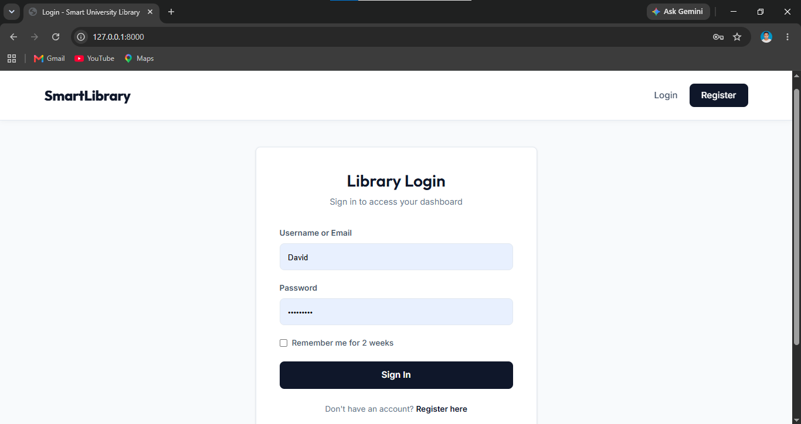
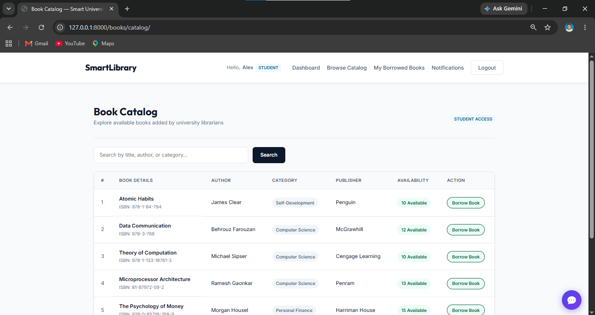
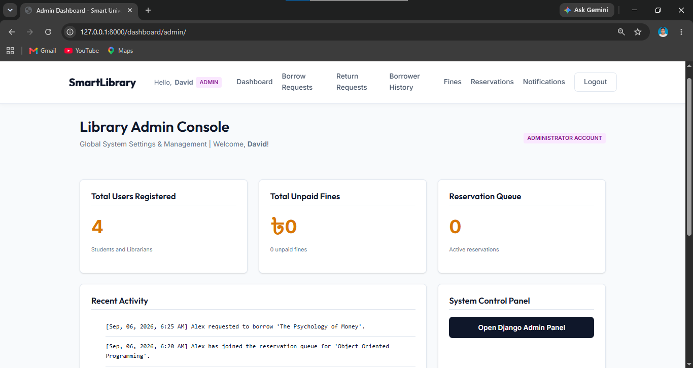
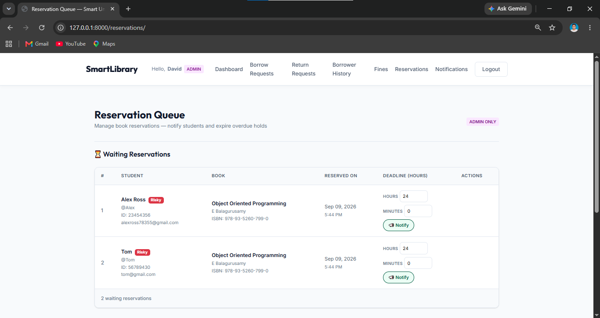
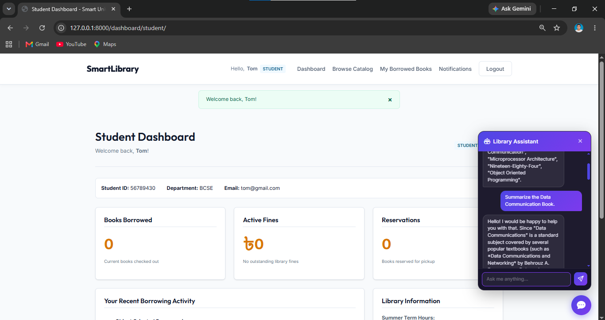
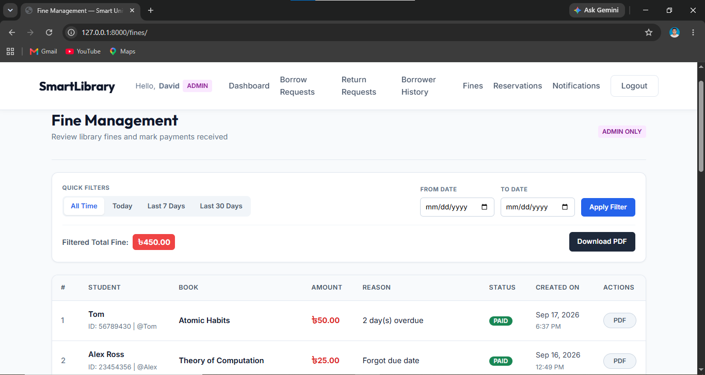

# 📚 Smart University Library Management System

A full-stack, AI-powered library management platform built with **Django**. It digitizes everyday library operations such as book management, borrowing, fine payment and reporting, and adds intelligent features like **semantic search** and an **AI chatbot** to help students find the right books faster.


---

## ✨ Features

### Core Library Management
- 🔐 **Authentication and role-based authorization** for students and administrators
- 📖 **Book catalog management** (add, update, delete, browse)
- 🔄 **Borrowing and return tracking**
- 💳 **Offline fine payment**
- 📊 **Fine management reports** for administrators
- 🧾 **Automated PDF generation** for fine reports, borrowing records and receipts
- 📌 **Book reservation** for students to reserve books that are currently unavailable

### AI-Powered Features
- 🔎 **Semantic search** using TF-IDF / sentence embeddings, so results match meaning rather than only exact keywords
- 🤖 **AI chatbot** that answers questions about book availability, library queries and navigation

---

## 🛠️ Tech Stack

| Layer | Technology |
|---|---|
| Backend | Python, Django |
| Frontend | HTML, CSS |
| Database | SQLite |
| AI / ML | TF-IDF, Sentence Embeddings |
| Payment | Offline (Admin Managed) |
| Reports | PDF generation ( Python Libraries for PDF Generation ) |
| Chatbot | Rule-based + NLP + LLM API |

---

## 📸 Screenshots

| Home Page | Book Search | Admin Dashboard |
|---|---|---|
|  |  |  |

| Reservations | Chatbot | Fine Payment |
|---|---|---|
|  |  |  |

---

## 🚀 Getting Started


### Prerequisites
- Python 3.9 or higher
- pip
- Git

### Environment Variables

Create a `.env` file in the project root:

```env
SECRET_KEY=your_django_secret_key
LLM_API_KEY=your_api_key
```

### Installation

```bash
# 1. Clone the repository
git clone https://github.com/Nobin-Hossain/Smart-Library-Management-System.git
cd Smart-Library-Management-System

# 2. Create and activate a virtual environment
python -m venv venv
source venv/bin/activate        # Windows: venv\Scripts\activate

# 3. Apply migrations
python manage.py makemigrations
python manage.py migrate

# 4. Create an admin account
python manage.py createsuperuser

# 5. Run the development server
python manage.py runserver
```

Open **http://127.0.0.1:8000/** in your browser.

## 🧠 How the AI Features Work

**Semantic Search:** Search queries and book descriptions are converted into vectors using TF-IDF / sentence embeddings. Books are ranked by similarity, so searching *"learning to code"* can surface *"Python Programming"* even without an exact keyword match.

**Chatbot:** Users can ask natural-language questions such as *"Is Clean Code available?"* and get instant answers, which reduces manual support work for library staff.

## 👨‍💻 Author

**Md. Nobin Hossain**
CSE Graduate, IUBAT, Dhaka, Bangladesh

- GitHub: [@Nobin-Hossain](https://github.com/Nobin-Hossain)
- LinkedIn: [Nobin Hossain](https://linkedin.com/in/nobin-hossain-79b286362)
- Email: nobinhossain3112@gmail.com

---

⭐ If you found this project useful, consider giving it a star!
